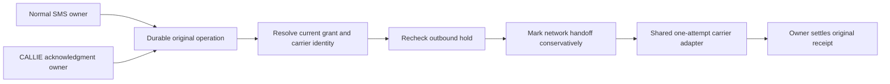

# GrowthOS communications compatibility: shared SMS boundary

Status: written design for review; human approval and implementation plan pending.
Owner: ROOT. Voice compatibility contribution: existing GEEKOM Codex task.
Source baseline: b95cb5fa1e1da1c0349427dbb20d5adc1088007e,
tree 910e15638af9c8988594570ea2dc6b79d83bc552, parent a237e837.
Date: October 16, 2026.

## Outcome and scope

Adam wants GrowthOS ready for both contractors' actual onboarding and workdays.
The retained direction is Telnyx transport, ElevenLabs Agents and GrowthOS business
logic. The current SMS producer and voice integration still use Twilio. A provider
change must retain existing consent, ownership, quotas, history and human routing.
All 33 actual acceptance cases remain unrun; this source design closes none of them.

The first implementation slice, C1, is a shared, typed physical SMS boundary used
by both existing dispatch owners. It preserves existing Twilio behavior, turns an
unsupported provider selection into an explicit refusal and creates a verifiable
seam for the later Telnyx adapter. C1 adds no provider configuration, route, table,
migration, credential, dependency or readiness flag. It does not enable Telnyx.

The later SMS storage/ingress and voice work are distinct subprojects. Their
compatibility requirements are retained here so C1 cannot accidentally constrain
them to Twilio identities or weaken their acceptance gates. They require their own
complete designs before implementation. This document requests approval of C1 and
its preserved interface obligations, not approval of unwritten later schemas.

## Context already established

The independently accepted diagnostics and runtime-preparation records remain in
Forge's October16 evidence directories. D02 secret-generation/concurrency and D03
atomic stopped-state/start guarantees remain unresolved. No communication design
clears either runtime gate, compatible recovery or hosted-release requirements.

GEEKOM's exact source findings are retained as a 9,576-byte report, SHA256
9197c6978817875e878bfae475d744a2ddffeae08c1d9d4fc70d381933895df2.
The larger 82-file source map remains peer custody. ROOT read the relevant local
baseline interfaces to specify this change; the peer report is not account proof.

| Existing surface | Preserved responsibility |
| --- | --- |
| `services/twilio-delivery.ts` | Normal SMS consent, recipient, payload, durable dispatch, final guards and outcome settlement. |
| `services/callie-runtime.ts` | One-call acknowledgment grant, original call/execution ownership, final authority and settlement. |
| `services/callie-ack-transport.ts` | Separate physical acknowledgment POST; currently duplicates the carrier handoff. |
| `services/twilio-sms-budget.ts` | One existing organization lock and counts across normal/CALLIE owned attempts, including failed/unknown attempts. |
| `services/providers.ts` | Current tenant dispatch selection and truthful Twilio/mock/disabled status; production does not fall back to a mock. |
| `routes/v1/twilio.ts` | Existing signed enrollment/inbound/status paths, original-operation correlation and STOP/HELP/replies. |
| `schema/twilio.ts`, `schema/callie.ts`, `schema/service-sms.ts` | Historical provider-specific IDs and composite parent/grant/receipt foreign keys. |
| `services/callie-reception-provider.ts`, `callie-reception-runtime.ts` | Existing ElevenLabs configuration/tool inspection, Twilio registration and one-transfer ownership. |

These paths are relative to `artifacts/api-server/src` except schema paths under
`lib/db/src`. Existing CALLIE and service-SMS foreign keys make a credential swap
or historical SID rename invalid. C1 leaves those tables and their data untouched.

## Approaches considered

1. **Selected: preserve the two business owners, share the physical carrier POST.**
   A small discriminated handoff separates carrier identity from business grants.
   Both owners keep their transactions and settlement. Existing wire requests and
   guard ordering are characterized before the extraction. This limits C1's risk
   and makes both sends visible to the later provider implementation.
2. Patch only the general sender. This would leave CALLIE acknowledgments on a
   separate physical path and make readiness reporting incomplete. Rejected.
3. Rename Twilio records and simultaneously replace SMS, voice and storage. This
   would mix historical identity, migration, callback and call-control risks in
   one slice. Rejected in favor of separately reviewed subprojects.

## C1 architecture

Business owners retain this order:

This is an internal application interface, not a new public API or generic
delivery framework. It uses the existing fetch transport and ten-second request
timeout. It adds no SDK retry layer, background queue, scheduler or provider call.

### Carrier identity and prepared request

The shared entry point is `postSmsOnce`. Its closed input union has a supported
`provider: "twilio"` branch with the current-identity resolver and synchronous
handoff callback, and an unsupported `provider: "telnyx"` branch carrying neither
resolver nor credentials. Unknown runtime discriminators are also unsupported.
They throw the fixed `sms_carrier_unsupported` error before secret resolution,
handoff callbacks or fetch. This branch is a refusal contract for later work;
no production selector or readiness response advertises Telnyx in C1.

The Twilio handoff contains only the existing account/key identity, messaging
service, recipient, exact message text, exact status callback and optional exact
From value. Credential values exist only in the server-side handoff closure and
request header. They never enter a public fingerprint, diagnostic, receipt,
newly manufactured error, UI payload or test snapshot. The adapter never logs or
serializes raw transport errors; original exception identity returns to the
existing owner and its current handling. Tests use synthetic fixed fixtures.

Normal customer-care and appointment contexts keep their original consent and
contact checks. CALLIE keeps its caller-requested one-call grant, not a contact
marketing grant. An origin label, `normal` or `callie_ack`, is useful for bounded
testing/diagnostics but grants no authority and selects no credential or tenant.

The supported carrier adapter receives a current-identity resolver and a handoff
callback. The resolver performs the owner's existing final checks. It runs once
for this attempt. If it throws, the adapter invokes neither the handoff callback
nor fetch. Immediately before calling fetch the shared boundary rechecks the
existing outbound hold, then invokes the callback at most once. If that callback
throws, no request occurs. A callback is not a durable ownership claim: each
business owner must already have acquired its existing permanent database claim.

The shared adapter returns the provider response to the same business owner.
Parsing, accepted-ID validation, suppressions, database settlement and error
causality remain in that owner in C1. In particular, C1 must not make one owner
adopt the other's subtly different failure or grant semantics. The extraction
preserves existing owner guard ordering and invocation counts, including the
second normal service-parent `beforeDispatch` check. Resolving the adapter's
identity once does not mean collapsing those business checks into one callback.

### Exact Twilio behavior to retain

The URL remains the current account-specific Twilio Messages endpoint. Retain
POST, form encoding, Basic authorization, `redirect: "error"` and the ten-second
abort. One invocation causes at most one fetch invocation; no redirect, timeout,
429, malformed body, missing ID, 5xx or database failure causes a resend.

The normal flow currently supplies From only for an exact service-SMS parent;
the CALLIE acknowledgment currently supplies no From field. Preserve both wire
shapes, including parameter values and message text. Do not force a sender field
or borrow a normal customer-care consent proof for the one-call grant. C1 must
not change canonical message/payload hashes, operation keys, callback URLs,
signature validation, provider-SID patterns or status ordering.

The old public function signatures stay usable. `sendTwilioSms` remains the
normal business owner; `postCallieAcknowledgment` can become a compatibility
wrapper over the shared adapter. Mocks in existing tests must be updated only
when they intercept the extracted physical boundary, without weakening assertions.

The normal owner's `dispatched` point remains after its final grant checks and
before fetch. CALLIE's existing callback serves the same conservative boundary.
A timeout after that point remains unknown even if an abort happened before a
packet demonstrably left the host. Local scheduling cannot prove non-delivery.
If final outbound checks or identity resolution fail before that point, preserve
the current blocked/cancelled behavior and permanent original ownership.

### Data and locking invariants

C1 makes no schema or SQL change. It retains the exact existing advisory-lock
namespace rather than renaming it while other writers use the old lock. Both
current tables remain counted under that same lock, and CALLIE/normal operation
ownership checks remain in their existing transactions. Every owned failed or
unknown operation still counts against the existing allowance.

A typed provider discriminator does not make an old operation eligible again.
No caller can choose a second provider after failure or uncertainty. There is no
new retry/reset endpoint, reconciler, lease or retryable status. An accepted
historical receipt continues to return its original provider/message identity.

## Subsequent Telnyx SMS contract obligations

These are design constraints for C2, not implemented features or a selected schema.
Before C2 can be implemented, its exact additive schema and each affected caller
must be written and reviewed together. The baseline tables remain historical.

The [Telnyx send reference](https://developers.telnyx.com/api-reference/messages/send-a-message)
documents JSON message submission with explicit sender/recipient/profile, text
and receipt URLs. A queued response is a provider acceptance record. C2 must not
display it as confirmed delivery. No SMS retry guarantee is established here.

The [webhook guide](https://developers.telnyx.com/docs/messaging/messages/receiving-webhooks)
documents event IDs, message IDs, `message.received`, `message.sent` and
`message.finalized`. The later handler must distinguish each identity. Final
carrier outcomes must remain distinct from an application's own send receipt.

The [official SDK verification example](https://github.com/team-telnyx/telnyx-node/blob/master/examples/webhook-verification/README.md)
preserves the raw request body. GrowthOS must verify the original bytes and
signed timestamp before business parsing, with a bounded replay window and
bounded input. Do not copy a reserialization example that changes signed bytes.

Required C2 behavior:

- A tenant-owned versioned Telnyx binding names exact account/profile/sender,
  public verification key and server secret references. No shared-global sender,
  unverified account assumption or production mock fallback. App organization IDs
  and provider organization IDs are separate namespaces.
- A future explicit provider selection applies only to new operations. Existing
  Twilio reservations, consent proofs, signed old receipts and history stay in
  their original namespace. An old approval does not authorize a new sender.
- New durable claims must check all legacy normal/CALLIE ownership under the
  existing common lock, and new claims must count with both legacy tables. A
  rolling mixed-writer deployment cannot be assumed safe: before activation,
  either every active writer uses the reviewed combined claim protocol or all
  incompatible writers are held. Merely adding a table cannot stop an old binary.
- Correlation must bind the original operation, immutable binding revision,
  profile, sender, recipient and exact submitted payload. Signed callbacks can
  reconcile lost submit responses without creating another attempt. A query
  operation ID, matching phone or matching text alone cannot claim an operation.
- Callbacks arriving before submit settlement are retained as authenticated
  evidence, not discarded or allowed to cause a second POST. Conflicting IDs,
  wrong tenants/profiles/addresses and terminal-outcome conflicts hold for review.
- Durable verified event intake precedes acknowledgment; duplicate delivery is
  idempotent. Never acknowledge a failed commit as retained. Processing may resume
  durable inbound work, but never repeat an outbound network effect.
- Revoking outbound authority must preserve the bounded historical verification
  material needed for legitimate old STOP/reply/status intake. It must not grant
  new sending. Old and new suppression/reply holds participate in current checks.

The [opt-out reference](https://developers.telnyx.com/docs/messaging/messages/advanced-opt-in-out)
describes profile-level blocking and `autoresponse_type` on inbound events.
The later design must respect that scope. GrowthOS must suppress immediately on
verified STOP evidence even with outbound sending disabled. HELP does not enroll;
START does not grant every purpose or silently clear an unrelated local hold.
Avoid a second application reply when the carrier already handles that response.
No account option or paid AI opt-out feature is activated by this design.

Full service-series, returning-customer and CALLIE callers require explicit C2
storage/grant compatibility; C1's shared function does not implement those models.
G06 estimate documents, revisions and resends remain a separate required capability.

## Subsequent voice compatibility contract obligations

Existing ElevenLabs functionality is retained. The problem is the Twilio-specific
registration, phone type, call history and transfer path. The later C3 design must
preserve the three allowed tools, tenant/session/configuration binding, admission
deadline, one registration/transfer claim and permanent unknown-result handling.
No existing CALLIE foreign key may be satisfied with a renamed Telnyx ID.

The [ElevenLabs SIP documentation](https://elevenlabs.io/docs/eleven-agents/phone-numbers/sip-trunking)
supports SIP-based phone integration and describes TLS/media options. Custom SIP
headers can appear as dynamic variables and in conversation history. Therefore
GrowthOS must never place API keys, bearer capabilities or session grant secrets
in those headers or agent-visible variables. A nonsecret correlation ID grants
no authority without independent authenticated server-side binding.

The [transfer documentation](https://elevenlabs.io/docs/eleven-agents/customization/tools/system-tools/transfer-to-number)
distinguishes SIP REFER from native Twilio transfer modes. This does not establish
that the current custom once-only GrowthOS handoff can safely invoke REFER. A
provider tool that bypasses the server claim is forbidden. Unsupported transfer
semantics remain a specific capability hold, not a guessed API.

The complete C3 design must establish authenticated call admission, exact agent/
phone/trunk binding, conversation-to-call identity, tool request authentication,
safe transfer trigger/evidence, unknown handling and a provider-neutral durable
call model. Cached public documentation is not proof of actual tenant routing,
header propagation, allowed destinations, handset behavior or account entitlement.

The [voice compatibility annex](2026-10-16-voice-compatibility-annex.md) is the
received GEEKOM proposal, retained with its explicit unresolved dependencies and
NOT_RUN criteria. It is an input for C3's later design, not a completed C3 contract
or permission to implement its conditional SIP recommendation. ROOT verified the
exact transport bytes and independently matched all eleven selected source Git
blobs. The six cached-document hashes remain peer-custody claims, distinct from
ROOT's separate current official-document reads.

In particular, preserve staff-first missed-call admission rather than silently
routing all calls directly to an AI agent. Registration ownership must precede
the actual physical connection effect. Both the Twilio-linked intake foreign keys
and the CA-only transfer-child constraint require a typed additive design before
any new-carrier call can be persisted. V01-V07 name the missing evidence; none is
filled by assuming a phone type or trusting a caller-supplied correlation header.

ROOT's additional narrow [dynamic-variable documentation read](https://elevenlabs.io/docs/eleven-agents/customization/personalization/dynamic-variables)
confirms a documented `secret__` mechanism for tool headers, exclusion from LLM
prompts/first messages, and redaction in post-call/conversation responses. This
narrows V03's generic mechanism question. Combining it with the documented
[SIP initiation response](https://elevenlabs.io/docs/eleven-agents/customization/personalization)
suggests a future server-injected call-scoped variable; that is an inference for
C3's design, not proven behavior for the actual selected configuration. Exact
call admission/corroboration, allowed header mapping, propagation and protected
per-call handling still require the complete C3 contract and its own evidence.
The original received annex remains unchanged as a dated input.

## Company policies and truthful readiness

Reuse dated Painless hours/nominees; CSS hours/timezone/on-call still require an
authoritative decision before company activation. Keep after-hours intake, human
routing, internal staff tasks/alerts and customer SMS as separate capabilities.
No sending-window widening, staff-number invention or emergency-routing promise.

Manual native-phone drafts remain unverified drafts. One-call acknowledgment
permission remains limited to that original call. Recurring/customer-care,
appointment, marketing and portal-auth purposes cannot borrow one another's grants.
Bundled subscription direction does not establish an allowance or overage price.

C1 does not change Settings or onboarding wording. Later truthful provider status
must distinguish configuration, code support, eligibility, operator approval,
provider acceptance and actual handset evidence. A saved setup step remains draft
and capture-disabled until the existing launch guard is satisfied.

## C1 file ownership and boundaries

ROOT owns the shared carrier contract/transport and sequential integration of the
two existing owners. Candidate implementation scope:

- A focused `services/sms-carrier-transport.ts` module and its behavioral tests.
- `services/twilio-delivery.ts`, only the physical-request seam and conservative
  dispatch marker needed to call the shared boundary.
- `services/callie-ack-transport.ts`, compatibility wrapper and exact handoff type.
- Existing normal/CALLIE/service dispatch tests as needed to characterize and
  prove preserved behavior; no weaker production guard or assertion.

`callie-runtime.ts` should remain unchanged if its existing wrapper signature is
sufficient. Any required change must be limited to adapting that internal type;
no ownership, state-machine or grant change belongs to C1. DB schema, nineteen SQL
files, generated API contracts, UI, settings, scheduler, provider status and voice
routes remain unchanged. No dependencies or account changes are expected.

GEEKOM owns only the separate voice-compatibility design contribution at this
stage. It has no shared source push or product implementation assignment. The
existing local reviewer independently reviews the written C1 specification.
All contributors preserve other agents' edits and exact historical receipts.

## C1 evidence required before acceptance

The implementation plan must turn these requirements into exact tests and owned
commands; no test has run for C1 during this docs-only stage.

| Case | Required observable result |
| --- | --- |
| Normal and CALLIE wire characterization | Exact existing URL/method/form/body/auth/header/callback behavior; service-parent From only where present today. |
| Final resolver rejects | No marker and no fetch; owner preserves the original blocked/cancelled receipt. |
| Outbound hold changes during resolver | Shared final hold refuses before network handoff. |
| Marker throws | No fetch, original error preserved; no attempt replay. |
| Fetch times out/throws/redirects | One fetch call only; each owner keeps its conservative unknown-effect semantics. |
| 429/5xx/malformed success/missing ID | Existing status/validation/ownership behavior; no retry or different carrier. |
| Accepted receipt replay | No fetch; returns original owned identity without mutating history. |
| Cross-owner duplicate/concurrent cap | Actual PostgreSQL barrier races preserve one logical owner and one existing combined allowance. |
| Stale grant/contact/sender/consent/reply hold | Existing final checks still block at the real owner; extracted transport cannot bypass them. |
| Unsupported provider | Refusal before credentials, marker or fetch; never Twilio credential reinterpretation or a mock. |
| Privacy | Shared code emits no logs/serialization and constructs no error containing credential/header/body/customer data; original exception handling stays with its existing owner. |

Run focused suites, required PostgreSQL races, whole workspace types, full current
release CI/build/parity and independent source review at the actual changed
candidate. Preserve earlier diagnostics/native receipts as historical; do not
repin those script-runtime maps unless affected source actually changes. Source
publication/CI must have an exact current decision and its own observed result.
No C1 implementation or release readiness is claimed before that evidence exists.

## Completion and later admission

C1 is complete only when both existing physical sends use the shared one-attempt
boundary, the listed preservation tests pass, actual independent review accepts
the source and no protected schema/SQL/provider/UI behavior drifts. A fake Telnyx
implementation, an unused interface or a readiness badge is insufficient.

After C1, separately freeze C2's complete SMS binding/storage/ingress/consumer
contract, then C3's supported voice/session/transfer/call-model contract. Preserve
their interdependencies: new-call acknowledgment cannot activate before both its
call model and SMS grant are supported. Existing deployments remain held until
full compatible recovery or verified complete writer hold/forward recovery,
hosted proof, full G04/G06 and both company/provider/device/workday/cutover gates
are satisfied. Source milestones do not substitute for those proofs.

This design authorizes no provider activation, legal submission, purchase, hosted
SQL, original-app runtime change, customer contact, push, merge, deployment or
public launch. Runtime-preparation proposals and all 33 NOT_RUN cases retain their
existing scope. Review of this written design precedes an implementation plan.
