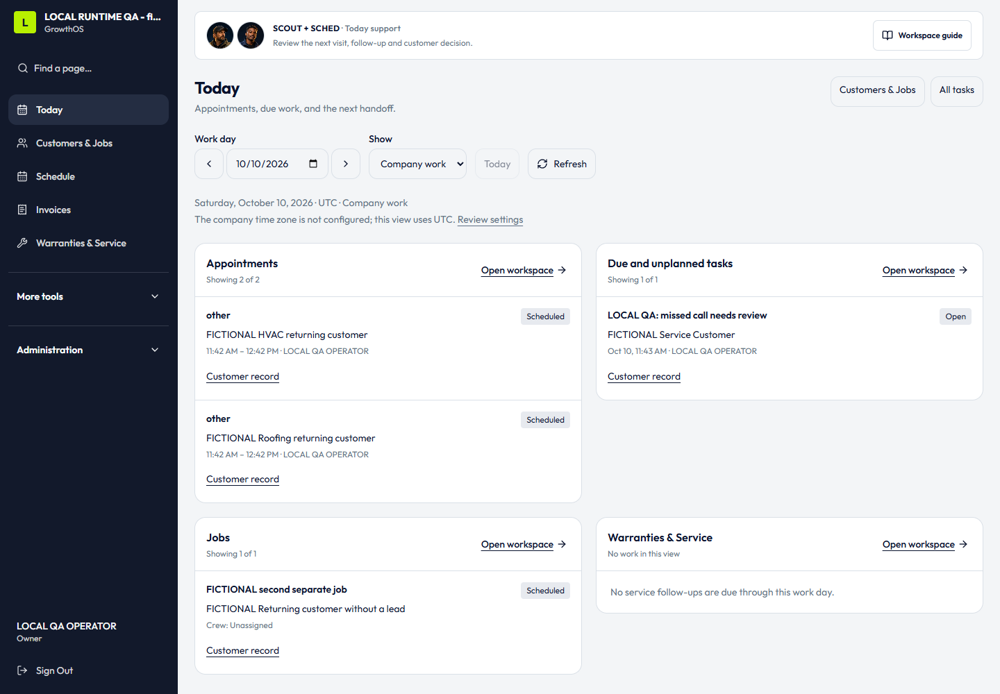
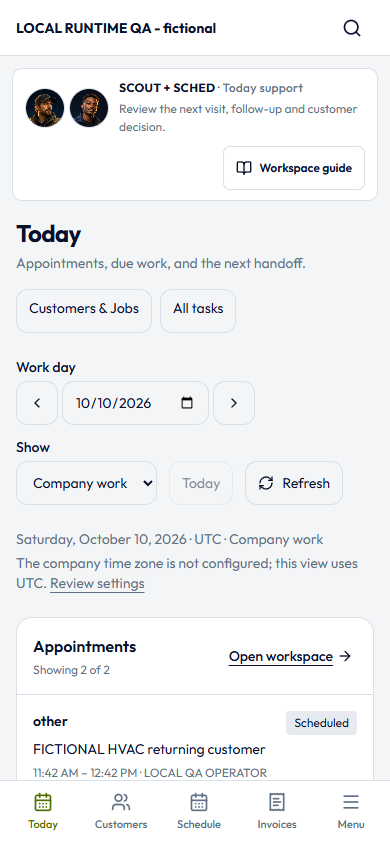

# Native integrated GrowthOS browser acceptance — October 10, 2026

Passed against integrated source `fe43ba1076cf0c863f50310d3153814dd3dd8ebc`
at `http://127.0.0.1:4193`. This is the actual signed-in native application,
with the disposable `--returning-customer --contractor-workday --customer-care`
database fixture. It is not the earlier isolated coverage-component demo.

The fictional Owner session belonged to **LOCAL RUNTIME QA - fictional**.
Existing local Playwright/Chrome 154 was reused. No dependencies were installed,
no browser profile or authentication state was exported, and recording, tracing
and video remained disabled. The preview remains running for Adam.

Reproduce after starting the isolated preview:

```powershell
node scripts/growthos-integrated-browser-qa.mjs
```

The script requires the existing global `@playwright/cli` package under APPDATA
and local Chrome at `C:/Program Files/Google/Chrome/Application/chrome.exe`.
It closes only its own isolated browser. Output and timestamps are in
`integrated-running-browser-2026-10-10.json`.

## Observed native behavior

- Signed in with the deliberately public local fixture credentials. Today
  fully loaded the fictional HVAC/roofing appointments, due callback task and
  returning-customer job. Desktop daily navigation opened Customers & Jobs,
  Schedule, Invoices and Warranties & Service.
- Opened the returning customer's canonical workspace from Contacts. Its Jobs,
  Estimates and Invoices sections loaded; the exact invoice link opened its
  authoritative recorded-balance panel. The invoice list displayed three issued
  documents, including the returning invoice's $110 recorded balance.
- Reviewed all 30 customer properties through the paginated picker. Explicitly
  selected a property from the second page, saved a fictional first-name and
  address-line correction through the native UI, and received HTTP 200 with a
  saved receipt. Reload independently showed both changed values. All three
  do-not-contact flags remained visible. A second audited UI correction restored
  the original name/address; no document, payment or provider action was taken.
- Service showed three fictional service records. Its existing linked visit
  opened the exact appointment and original `0 FICTIONAL Workday Lane` property.
  Existing office scheduling notes remained displayed on the schedule.
- Opened the actual fictional lead from Pipeline. Owner-only alert coverage
  truthfully stated that the original coverage was not recorded and the cohort
  was unknown. Refresh made exactly one coverage GET. It offered no resend or
  inferred reconstruction of historical recipients.
- Opened Specialists through More tools. SCHED's workspace guide opened native
  Schedule; automatic route optimization remained explicitly described as Planned.
- At 390×844 and 320×844, inspected Today, Contacts, the customer workspace,
  Schedule, Invoices, Service, Specialists and the native lead coverage. All 16
  mobile combinations had document/body widths equal to the viewport. The
  mobile menu opened Service and closed after navigation, and quick Today
  returned to the loaded workday. Desktop Today also measured 1440/1440 pixels.
- No uncaught browser page errors or unexpected failed application responses.
  Expected 404 reads were limited to missing Smart Site inquiry ownership and
  missing playbook enrollment on the standard fictional lead. The recorded
  non-GET requests were sign-in and the two customer correction saves only.

## Visual evidence

Both screenshots show the fully loaded native Today URL
`http://127.0.0.1:4193/`. The 1440×1000 desktop and 390×844 phone images were
visually inspected for wrapping and navigation placement.





## Explicit limits

The standard lead is not a Smart Site inquiry. Its ownership read returns 404
and the ownership panel correctly stays hidden. Claiming a real inquiry,
evaluated recipient cohorts, device delivery and phone display are not browser
proof from this fixture; their source tests remain separate evidence.

The fixture has no accepted company timezone setup: Today explicitly shows the
UTC fallback. This screenshot is not evidence of a real contractor's configured
workday or schedule timezone.

This is local, fictional acceptance only. Hosted rollout, production recovery,
provider delivery, actual contractor acceptance, payments and financial
settlement are not established. The preview runner retains outbound holds and
excludes provider credentials. Original fictional values were restored through
audited corrections; their test receipts remain in the disposable database.
